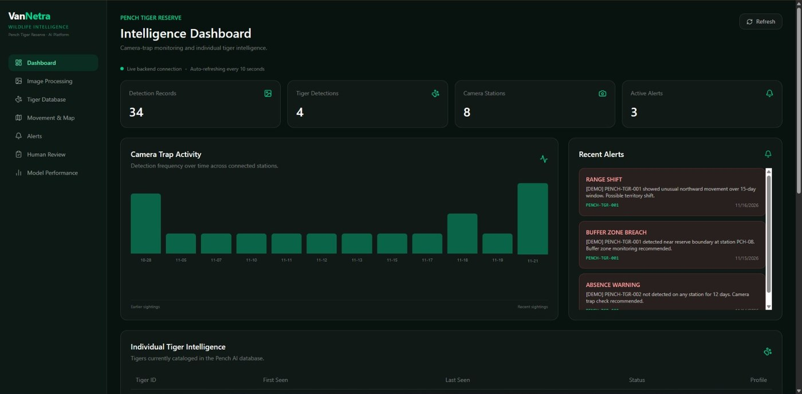
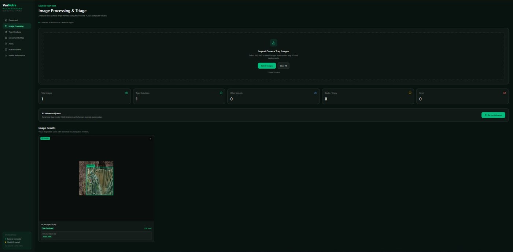
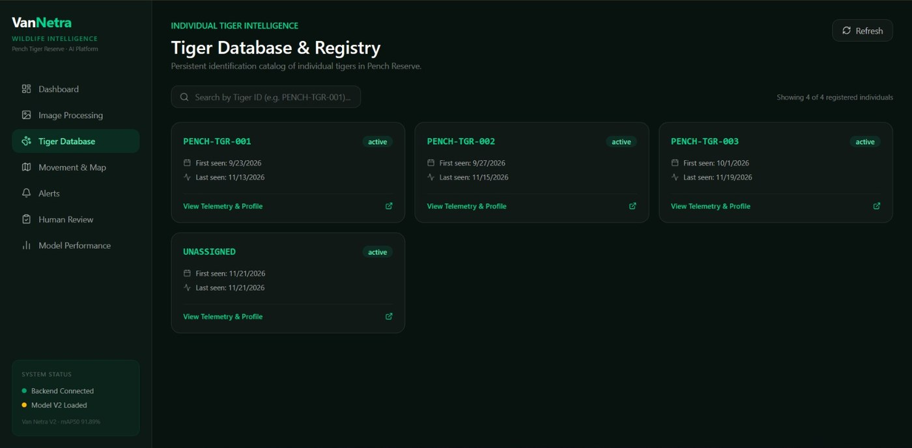
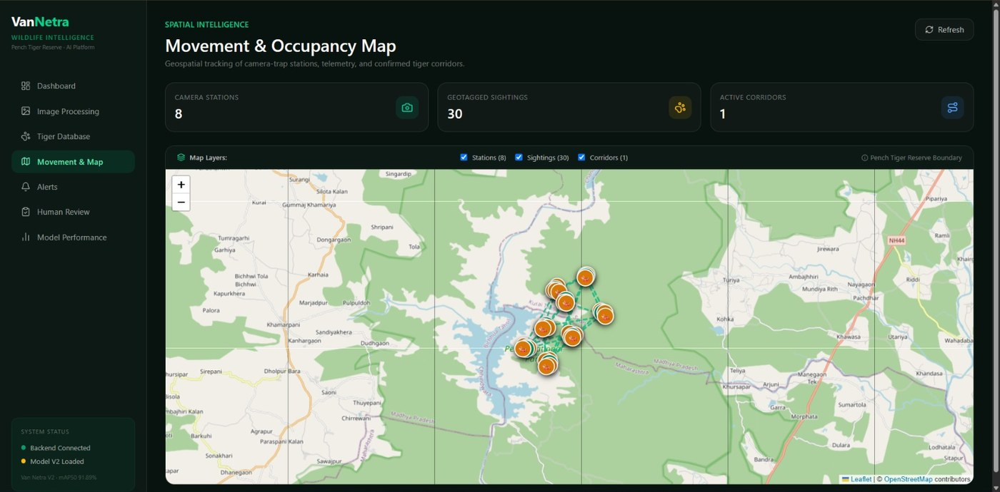
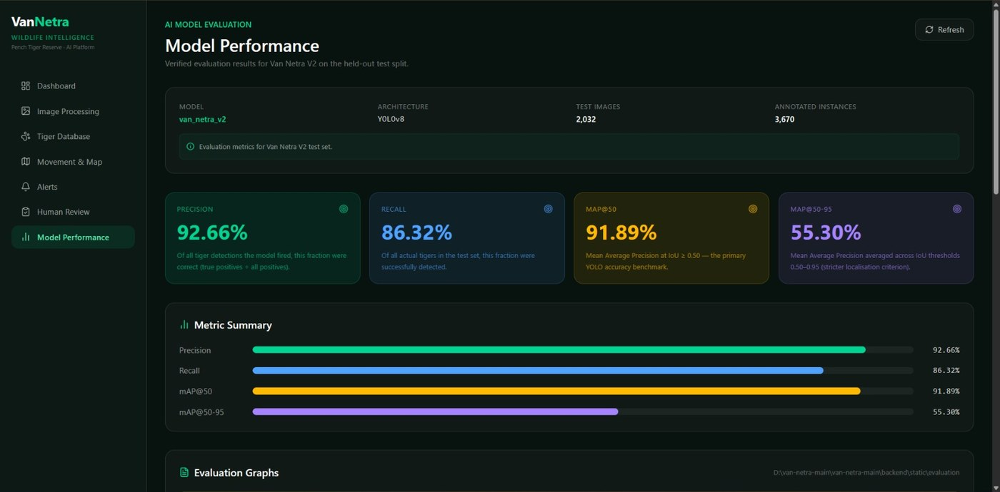

<div align="center">

# Van Netra AI
### AI-Powered Wildlife Monitoring & Intelligence Platform

**Turning camera-trap imagery into actionable wildlife intelligence.**

[](https://react.dev/)
[](https://fastapi.tiangolo.com/)
[](https://www.ultralytics.com/)
[](https://www.sqlite.org/)

</div>

---

## Overview

**Van Netra AI** is an AI-powered wildlife monitoring platform designed to support camera-trap image analysis, tiger detection, individual wildlife records, camera-station monitoring, alerts, human verification and geospatial visualization.

The project was developed for **Manthan 4 Yuva at VNIT Nagpur (2026)** and has been further developed beyond the initial hackathon prototype.

The application brings together a computer-vision pipeline and a web-based intelligence dashboard to help organize wildlife detections and related monitoring information.

## Application Preview


<p align="center"><em>Intelligence dashboard — monitoring summary, camera-trap activity, alerts and registered tiger records.</em></p>

## Key Features

- **AI-assisted image processing:** Analyze camera-trap images using trained YOLO model weights.
- **Tiger detection:** Identify tiger instances in submitted images.
- **Object and human detection:** Display other detected classes supported by the configured model pipeline.
- **Wildlife registry:** Maintain individual tiger records and profile information.
- **Camera-station monitoring:** Organize camera stations and associated detection records.
- **Human-in-the-loop review:** Allow reviewers to confirm detections or mark false alarms.
- **Alerts:** Present movement, territory and buffer-zone-related alert records.
- **Geospatial visualization:** Display station and sighting information on an interactive map.
- **Model evaluation dashboard:** Present model metrics and evaluation visualizations.

## Screenshots

### 1. Camera-Trap Image Processing


<p align="center"><em>Image processing interface with an example detection result.</em></p>

### 2. Individual Tiger Registry


<p align="center"><em>Tiger registry with individual record identifiers and profile access.</em></p>

### 3. Movement & Occupancy Map


<p align="center"><em>Geospatial view of camera stations, geotagged sightings and mapped corridors.</em></p>

### 4. Model Performance


<p align="center"><em>Model evaluation dashboard. The displayed values correspond to the evaluation view captured from this project build.</em></p>

## Technology Stack

| Layer | Technologies |
|---|---|
| Frontend | React 19, TypeScript, Vite, Tailwind CSS |
| Visualization & Mapping | Recharts, Leaflet |
| Backend | Python 3.12, FastAPI |
| Computer Vision | Ultralytics YOLO, OpenCV |
| Database | SQLite |

## Requirements

- Windows 10 or Windows 11
- Python 3.12
- Node.js 20.19+ (Node.js 24 recommended)
- npm

## Installation

### 1. Clone the repository

```powershell
git clone https://github.com/um034867-sys/Van-Netra-AI.git
cd Van-Netra-AI
```

### 2. Create and activate the Python environment

```powershell
py -3.12 -m venv .venv
.\.venv\Scripts\Activate.ps1
python -m pip install --upgrade pip
pip install -r backend\requirements.txt
```

### 3. Install frontend dependencies

```powershell
npm ci
```

### 4. Configure model weights

The trained tiger model and general YOLO model are not included in this repository.

Place compatible model files at the following paths:

```text
backend/
├── runs/
│   └── detect/
│       └── van_netra_v2/
│           └── weights/
│               └── best.pt
└── yolo11n.pt
```

Both files are required for the complete AI detection workflow described by this project. Obtain model files only from sources whose terms permit your intended use.

### 5. Start Van Netra AI

From the project root, run:

```powershell
Set-ExecutionPolicy -Scope Process Bypass
.\start_penchai.ps1
```

The startup script initializes demo data and starts the backend and frontend in separate terminal windows. Keep both windows open while using the application.

## Application URLs

| Service | URL |
|---|---|
| Frontend | http://localhost:5174 |
| Backend | http://127.0.0.1:8001 |
| API documentation | http://127.0.0.1:8001/docs |
| Health check | http://127.0.0.1:8001/health |

## Project Structure

```text
Van-Netra-AI/
├── backend/
│   ├── main.py
│   ├── detector.py
│   ├── database.py
│   ├── seed_demo_data.py
│   ├── requirements.txt
│   └── static/
│       └── evaluation/
├── docs/
│   └── screenshots/
├── public/
├── src/
├── package.json
├── package-lock.json
└── start_penchai.ps1
```

## Important Notes

- Model weights and training datasets are not included in the repository.
- Compatible model files are required for the complete AI detection workflow.
- Demo records are initialized locally; screenshots may show demonstration data.
- SQLite databases are generated locally.
- Evaluation images are included in `backend/static/evaluation/`.
- Map markers, corridors and sighting records should be interpreted according to the data configured in the local application; demo data should not be represented as verified field observations.

## Development

### Build the frontend

```powershell
npm run build
```

### Run the frontend independently

```powershell
npm run dev -- --port 5174 --strictPort
```

### Run the backend independently

From the project root:

```powershell
.\.venv\Scripts\python.exe -m uvicorn backend.main:app --host 127.0.0.1 --port 8001
```

## License

The project is stated to use the **GNU Affero General Public License v3.0 (AGPL-3.0)**. Review the repository's `LICENSE` file and the licenses of all third-party dependencies and model weights before redistribution or deployment. Ultralytics model/software licensing can impose obligations depending on how the software is used and distributed; do not assume that one license statement automatically covers every asset in the repository.

## Repository

[https://github.com/um034867-sys/Van-Netra-AI](https://github.com/um034867-sys/Van-Netra-AI)

---

<div align="center">

**Van Netra AI**  
*Supporting wildlife monitoring through computer vision, data and geospatial intelligence.*

</div>
